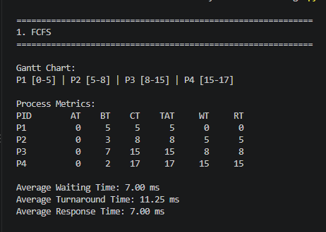
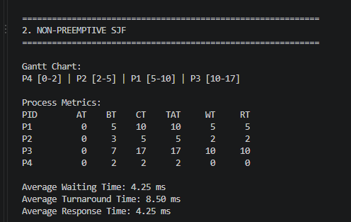
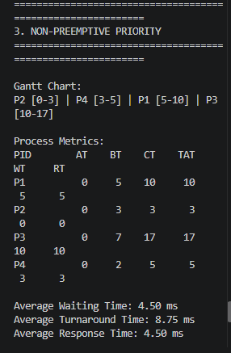
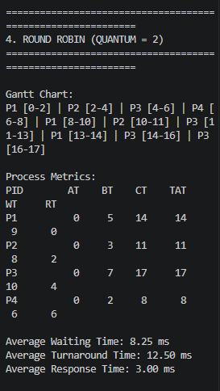

# OS Laboratory 2 – CPU Scheduling Algorithms

**Course:** BCA151 – Operating Systems Laboratory  
**Institution:** Mindanao State University – Iligan Institute of Technology  
**College:** College of Computer Studies  
**Department:** Department of Computer Applications  
**Activity:** Laboratory Activity 2 – CPU Scheduling Algorithms

---

## I. Introduction

CPU scheduling is an important function of an operating system. It determines which process will use the CPU and for how long. Different scheduling algorithms use different rules to improve CPU utilization, reduce waiting time, and provide better system performance.

This activity implements five CPU scheduling algorithms using Python: First Come, First Served (FCFS), Non-Preemptive Shortest Job First (SJF), Non-Preemptive Priority Scheduling, Round Robin (RR), and Shortest Remaining Time First (SRTF).

The program displays Gantt charts, completion time, turnaround time, waiting time, response time, and average performance metrics for each algorithm.

## II. Objectives

1. Implement different CPU scheduling algorithms using Python.
2. Understand the differences between preemptive and non-preemptive scheduling.
3. Generate Gantt charts to represent process execution.
4. Calculate completion time, turnaround time, waiting time, and response time.
5. Compare the performance of different scheduling algorithms.
6. Understand the effect of the Round Robin time quantum.
7. Use Git and GitHub to manage and submit source code.

## III. Technologies Used

- Python 3
- Visual Studio Code
- Git
- GitHub

## IV. Project Structure

```text
OS-Laboratory-2-CPU-Scheduling/
│
├── cpu_scheduling.py
├── README.md
│
└── screenshots/
    ├── fcfs.png
    ├── sjf.png
    ├── priority.png
    ├── round_robin.png
    └── srtf.png
```

## V. Process Datasets

### A. Main Dataset

The following modified dataset is used for FCFS, SJF, Priority Scheduling, and Round Robin.

| Process | Arrival Time (AT) | Burst Time (BT) | Priority |
|---|---:|---:|---:|
| P1 | 0 | 5 | 3 |
| P2 | 0 | 3 | 1 |
| P3 | 0 | 7 | 4 |
| P4 | 0 | 2 | 2 |

### B. Separate SRTF Dataset

SRTF uses a separate dataset with different arrival times to demonstrate preemption.

| Process | Arrival Time (AT) | Burst Time (BT) | Priority |
|---|---:|---:|---:|
| P1 | 0 | 8 | 2 |
| P2 | 1 | 4 | 1 |
| P3 | 2 | 2 | 4 |
| P4 | 3 | 1 | 3 |

**Scheduling assumptions:**

- A smaller priority number indicates a higher priority.
- Round Robin uses a default time quantum of 2 ms.
- SJF and Priority Scheduling are non-preemptive.
- FCFS uses arrival order, with process ID breaking arrival-time ties.
- SRTF uses the separate arrival-time dataset.

## VI. Scheduling Algorithms and Results

### 1. First Come, First Served (FCFS)

FCFS executes processes in the order they arrive. Once a process starts, it continues until its CPU burst is completed.

**Gantt Chart:**

```text
P1 [0-5] | P2 [5-8] | P3 [8-15] | P4 [15-17]
```

**Process Metrics:**

| PID | AT | BT | CT | TAT | WT | RT |
|---|---:|---:|---:|---:|---:|---:|
| P1 | 0 | 5 | 5 | 5 | 0 | 0 |
| P2 | 0 | 3 | 8 | 8 | 5 | 5 |
| P3 | 0 | 7 | 15 | 15 | 8 | 8 |
| P4 | 0 | 2 | 17 | 17 | 15 | 15 |

**Average Waiting Time:** 7.00 ms  
**Average Turnaround Time:** 11.25 ms  
**Average Response Time:** 7.00 ms

**Screenshot:**



### 2. Non-Preemptive Shortest Job First (SJF)

SJF selects the available process with the shortest burst time. The selected process runs until completion.

**Gantt Chart:**

```text
P4 [0-2] | P2 [2-5] | P1 [5-10] | P3 [10-17]
```

**Process Metrics:**

| PID | AT | BT | CT | TAT | WT | RT |
|---|---:|---:|---:|---:|---:|---:|
| P1 | 0 | 5 | 10 | 10 | 5 | 5 |
| P2 | 0 | 3 | 5 | 5 | 2 | 2 |
| P3 | 0 | 7 | 17 | 17 | 10 | 10 |
| P4 | 0 | 2 | 2 | 2 | 0 | 0 |

**Average Waiting Time:** 4.25 ms  
**Average Turnaround Time:** 8.50 ms  
**Average Response Time:** 4.25 ms

**Screenshot:**



### 3. Non-Preemptive Priority Scheduling

Priority Scheduling selects the ready process with the highest priority. In this program, a smaller priority number represents a higher priority.

**Gantt Chart:**

```text
P2 [0-3] | P4 [3-5] | P1 [5-10] | P3 [10-17]
```

**Process Metrics:**

| PID | AT | BT | CT | TAT | WT | RT |
|---|---:|---:|---:|---:|---:|---:|
| P1 | 0 | 5 | 10 | 10 | 5 | 5 |
| P2 | 0 | 3 | 3 | 3 | 0 | 0 |
| P3 | 0 | 7 | 17 | 17 | 10 | 10 |
| P4 | 0 | 2 | 5 | 5 | 3 | 3 |

**Average Waiting Time:** 4.50 ms  
**Average Turnaround Time:** 8.75 ms  
**Average Response Time:** 4.50 ms

**Screenshot:**



### 4. Round Robin (RR)

Round Robin assigns each ready process a fixed time quantum. If a process is not completed within its time slice, it returns to the end of the ready queue.

**Time Quantum:** 2 ms

**Gantt Chart:**

```text
P1 [0-2] | P2 [2-4] | P3 [4-6] | P4 [6-8] |
P1 [8-10] | P2 [10-11] | P3 [11-13] |
P1 [13-14] | P3 [14-16] | P3 [16-17]
```

**Process Metrics:**

| PID | AT | BT | CT | TAT | WT | RT |
|---|---:|---:|---:|---:|---:|---:|
| P1 | 0 | 5 | 14 | 14 | 9 | 0 |
| P2 | 0 | 3 | 11 | 11 | 8 | 2 |
| P3 | 0 | 7 | 17 | 17 | 10 | 4 |
| P4 | 0 | 2 | 8 | 8 | 6 | 6 |

**Average Waiting Time:** 8.25 ms  
**Average Turnaround Time:** 12.50 ms  
**Average Response Time:** 3.00 ms

**Screenshot:**



### 5. Shortest Remaining Time First (SRTF)

SRTF is a preemptive version of SJF. It selects the process with the shortest remaining burst time. A running process may be interrupted if another process arrives with a shorter remaining time.

**Gantt Chart:**

```text
P1 [0-1] | P2 [1-2] | P3 [2-4] |
P4 [4-5] | P2 [5-8] | P1 [8-15]
```

**Process Metrics:**

| PID | AT | BT | CT | TAT | WT | RT |
|---|---:|---:|---:|---:|---:|---:|
| P1 | 0 | 8 | 15 | 15 | 7 | 0 |
| P2 | 1 | 4 | 8 | 7 | 3 | 0 |
| P3 | 2 | 2 | 4 | 2 | 0 | 0 |
| P4 | 3 | 1 | 5 | 2 | 1 | 1 |

**Average Waiting Time:** 2.75 ms  
**Average Turnaround Time:** 6.50 ms  
**Average Response Time:** 0.25 ms

**Screenshot:**


## VII. Comparison of Average Performance

The following table compares the average metrics produced by the implemented program.

| Algorithm | Average WT | Average TAT | Average RT |
|---|---:|---:|---:|
| FCFS | 7.00 ms | 11.25 ms | 7.00 ms |
| SJF | 4.25 ms | 8.50 ms | 4.25 ms |
| Priority | 4.50 ms | 8.75 ms | 4.50 ms |
| Round Robin (q=2) | 8.25 ms | 12.50 ms | 3.00 ms |
| SRTF | 2.75 ms | 6.50 ms | 0.25 ms |

**Note:** SRTF uses a separate arrival-time dataset. Its averages should not be directly compared with the first four algorithms as though they used identical input data.

### Analysis

- FCFS follows arrival order but can produce longer waiting times when a long process executes before shorter processes.
- SJF achieves the lowest average waiting time among the first four algorithms in the modified main dataset.
- Priority Scheduling gives preference to processes with smaller priority numbers.
- Round Robin provides regular CPU access and achieves a relatively low average response time.
- SRTF demonstrates preemption and produces the lowest averages in its separate dataset.

## VIII. Formulas Used

| Metric | Formula |
|---|---|
| Completion Time (CT) | Time when the process finishes |
| Turnaround Time (TAT) | CT − AT |
| Waiting Time (WT) | TAT − BT |
| Response Time (RT) | First CPU Start − AT |
| Average Metric | Sum of metric values ÷ Number of processes |

### Sample Manual Calculations

**FCFS – P2**

- AT = 0
- BT = 3
- CT = 8
- TAT = CT − AT = 8 − 0 = 8 ms
- WT = TAT − BT = 8 − 3 = 5 ms
- RT = First CPU Start − AT = 5 − 0 = 5 ms

**SJF – P4**

- AT = 0
- BT = 2
- CT = 2
- TAT = 2 − 0 = 2 ms
- WT = 2 − 2 = 0 ms
- RT = 0 − 0 = 0 ms

**Priority – P2**

- AT = 0
- BT = 3
- CT = 3
- TAT = 3 − 0 = 3 ms
- WT = 3 − 3 = 0 ms
- RT = 0 − 0 = 0 ms

**Round Robin – P2**

- AT = 0
- BT = 3
- CT = 11
- TAT = 11 − 0 = 11 ms
- WT = 11 − 3 = 8 ms
- RT = 2 − 0 = 2 ms

**SRTF – P2**

- AT = 1
- BT = 4
- CT = 8
- TAT = 8 − 1 = 7 ms
- WT = 7 − 4 = 3 ms
- RT = 1 − 1 = 0 ms

## IX. Round Robin Time Quantum Experiment

The program uses a default Round Robin quantum of 2 ms.

To perform the required experiment, change the `RR_QUANTUM` value in `cpu_scheduling.py` to 4 and then to 1. Save and rerun the program for each value.

Record the actual average waiting time, turnaround time, and response time displayed by the program.

**Current verified result (q = 2):**

- Average Waiting Time: 8.25 ms
- Average Turnaround Time: 12.50 ms
- Average Response Time: 3.00 ms

**Observations:**

1. A smaller time quantum gives processes more frequent opportunities to execute.
2. A larger time quantum allows processes to run longer during each turn.
3. When the quantum becomes very large, Round Robin behaves more like FCFS.
4. A very small quantum can increase context-switching overhead because the CPU switches between processes more frequently.

## X. Guide Questions

**28. What is CPU scheduling, and why is it necessary?**

CPU scheduling is the process of selecting which process should use the CPU next. It is necessary to manage CPU resources efficiently, improve system performance, reduce waiting time, and allow multiple processes to execute effectively.

**29. What is the difference between FCFS and SJF?**

FCFS executes processes in the order they arrive. SJF selects the available process with the shortest CPU burst time. FCFS is simple, while SJF can reduce average waiting time.

**30. Why can SJF produce a lower average waiting time than FCFS?**

SJF can produce a lower average waiting time because it executes shorter processes first, allowing them to finish quickly instead of waiting behind longer processes.

**31. How does Priority Scheduling determine the next process?**

Priority Scheduling selects the ready process with the highest priority. In this laboratory, a lower priority number represents a higher priority. For example, a process with priority 1 is selected before a process with priority 3.

**32. What is starvation? Which algorithms can experience it?**

Starvation occurs when a process waits for a very long time because other processes are repeatedly selected before it. SJF and Priority Scheduling can experience starvation, particularly when new short jobs or higher-priority processes continually arrive.

**33. How does Round Robin improve responsiveness for interactive processes?**

Round Robin assigns each process a fixed time quantum. When its time expires, the CPU can switch to another ready process. This gives processes regular opportunities to execute and improves responsiveness for interactive users.

**34. What is the effect of changing the Round Robin time quantum?**

A smaller quantum allows processes to receive CPU time more frequently, improving response time but increasing context-switching overhead. A larger quantum reduces switching frequency but may increase response time. When the quantum is sufficiently large, Round Robin behaves more like FCFS.

**35. How does SRTF differ from non-preemptive SJF?**

Non-preemptive SJF selects the process with the shortest burst time and allows it to finish without interruption. SRTF selects the process with the shortest remaining execution time and can interrupt the current process when a more suitable process arrives.

**36. Why do preemptive algorithms require the operating system to save and restore process context?**

Preemptive algorithms may interrupt a running process to execute another one. The operating system saves the current process's state, such as its registers and program counter, and restores the next process's state so both processes can resume correctly.

**37. Does the algorithm with the lowest average waiting time always provide the best user experience? Explain.**

No. The lowest average waiting time does not always guarantee the best user experience. Response time, fairness, starvation, context-switching overhead, and the needs of interactive processes must also be considered.

**38. Why is it important to use the same dataset when comparing algorithms?**

Using the same dataset ensures a fair comparison because every algorithm processes the same processes, burst times, arrival times, and priorities. Differences in the results can then be attributed to the scheduling algorithms rather than different input data.

**39. What role does GitHub play in managing and submitting your laboratory work?**

GitHub provides a remote repository for storing, managing, and submitting laboratory files. It tracks changes through commits, maintains version history, and allows the instructor to access the source code and review the submitted work.

## XI. Conclusion

This laboratory activity demonstrated the implementation and comparison of five CPU scheduling algorithms: First Come, First Served (FCFS), Non-Preemptive Shortest Job First (SJF), Non-Preemptive Priority Scheduling, Round Robin (RR), and Shortest Remaining Time First (SRTF).

By executing the Python program, I observed how each algorithm determines process execution order and affects completion time, turnaround time, waiting time, and response time.

The experiments showed that different scheduling algorithms produce different performance results depending on their selection policies and the process dataset. In the modified main dataset, SJF achieved the lowest average waiting time among FCFS, SJF, Priority Scheduling, and Round Robin with a 2 ms quantum. The Round Robin experiment also demonstrated how changing the time quantum affects scheduling behavior and performance.

Overall, this activity improved my understanding of CPU scheduling, process management, and performance evaluation. I also gained practical experience implementing algorithms in Python, interpreting Gantt charts, calculating scheduling metrics, and using GitHub to manage and submit source code.

## XII. Required Deliverables

- GitHub repository link: https://github.com/Kelixtine/OS-Laboratory-2-CPU-Scheduling
- Completed Python source code (`cpu_scheduling.py`)
- Screenshots of the program running
- Gantt charts for all five algorithms
- Calculation tables showing CT, TAT, WT, and RT
- Comparison table of average metrics
- Results of the Round Robin time-quantum experiment
- Answers to guide questions 28–39
- Brief analysis and conclusion

